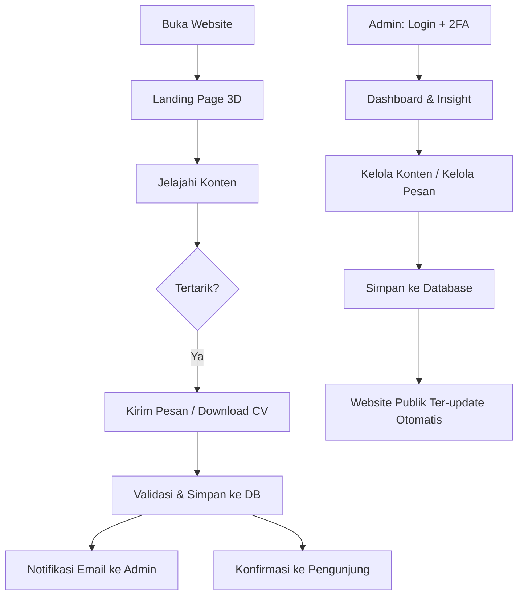
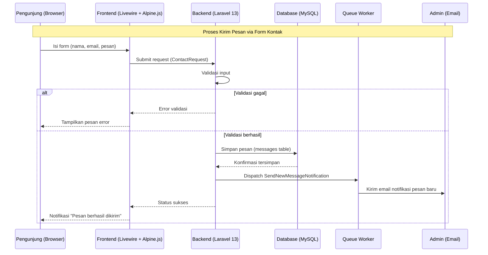
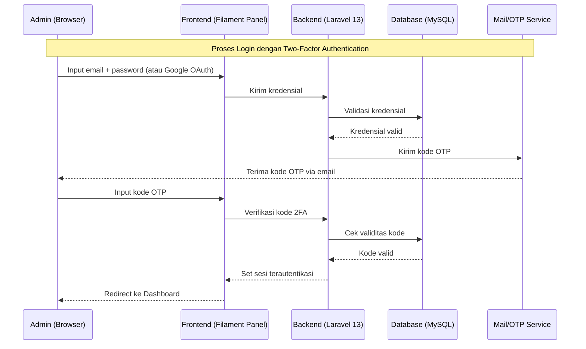
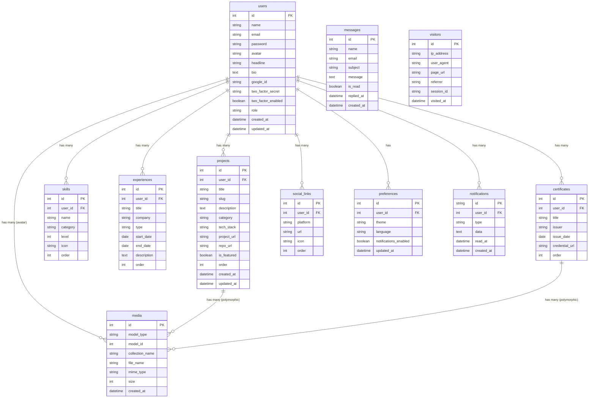

# PRD — Project Requirements Document
## Personal Portfolio Website (Laravel 13)

> **Versi:** v1.0.0 · **Tanggal Mulai:** Minggu 1 · **Target Selesai:** 16 Minggu

---

## 0. Ringkasan Revisi dari Konsep Awal

Dokumen ini disusun dari konsep awal Anda (*Konsep Website Portofolio*) dan direstrukturisasi ke format PRD standar, sekaligus direvisi untuk menggunakan **Laravel 13** (rilis Maret 2026) sebagai pengganti Laravel 10. Perubahan utama:

| Aspek | Konsep Awal | Revisi (PRD ini) | Alasan |
|---|---|---|---|
| Framework | Laravel 10 | **Laravel 13** | Permintaan Anda; rilis stabil dengan breaking changes minimal |
| PHP | PHP 8.2 | **PHP 8.3+** (didukung s.d. 8.5) | Laravel 13 mewajibkan minimum PHP 8.3 |
| Admin Panel | Filament v3 | **Filament v4** | v3 tidak kompatibel dengan Laravel 13; v4 memakai Schema API baru dan minimum Laravel 11.28+ |
| Styling | Tailwind CSS v3 | **Tailwind CSS v4** | Wajib untuk Filament v4; engine baru (Lightning CSS) 5x lebih cepat, konfigurasi CSS-native (tanpa `tailwind.config.js`) |
| Auth dasar | Laravel Breeze/Fortify | Tetap **Breeze/Fortify**, disesuaikan skema Laravel 13 | Masih kompatibel penuh |
| Animasi | GSAP + ScrollTrigger | Tetap, dengan catatan **seluruh plugin GSAP (ScrollTrigger, SplitText, dll.) kini 100% gratis** sejak akuisisi Webflow (April 2025) | Tidak ada lagi batasan lisensi "Club GreenSock" |
| Sisanya | Socialite, Spatie Media Library, Livewire, Alpine.js, Vite, Telescope | Tetap dipakai, versi mengikuti rilis terbaru yang kompatibel Laravel 13 | Tidak ada perubahan besar pada API paket ini |

Detail lengkap tiap keputusan ada di **Bagian 7 (Design & Technical Constraints)**.

---

## 1. Overview

Aplikasi ini adalah **website portofolio profesional dan modern** dengan elemen 3D interaktif dan konten dinamis, dilengkapi **panel admin** untuk pengelolaan konten. Masalah utama yang ingin diselesaikan adalah portofolio statis yang sulit di-update (harus edit kode), tidak menampilkan kredibilitas secara terstruktur (project, skill, pengalaman, sertifikat tersebar), dan tidak memberi insight kepada pemiliknya (siapa yang mengunjungi, siapa yang menghubungi).

Tujuan utama aplikasi adalah menyediakan platform web yang memungkinkan **satu Admin (pemilik portofolio)** menampilkan karya, keterampilan, dan pengalaman profesional secara terstruktur untuk **menarik klien atau pemberi kerja**, **membangun personal branding**, dan **meningkatkan kredibilitas digital** — sambil memberi Admin kendali penuh untuk mengelola seluruh konten tanpa menyentuh kode.

**Tujuan Bisnis:**
- Membangun personal branding yang profesional di dunia digital
- Menampilkan portofolio karya, skill, dan pengalaman secara terstruktur
- Menarik klien freelance dan peluang kerja baru
- Meningkatkan kredibilitas dan kepercayaan calon employer/klien

---

## 2. Requirements

### 2.1 Aksesibilitas & Platform
- **Web-based**, responsif penuh untuk Desktop, Tablet, dan Mobile.
- Wajib mendukung **tema gelap/terang/sistem** dan **dua bahasa (Indonesia/English)**, baik untuk pengunjung maupun Admin.
- Preferensi tema & bahasa pengunjung disimpan secara lokal (browser), sedangkan preferensi Admin disimpan di database agar konsisten di semua perangkat login.

### 2.2 Target Pengguna & Persona

**Persona A — Pengunjung (public)**
| Tipe | Kebutuhan |
|---|---|
| Klien potensial | Membutuhkan jasa developer/desainer, ingin cepat menilai kualitas kerja |
| Recruiter / HRD | Mencari kandidat untuk posisi tertentu, butuh info skill & pengalaman yang jelas |
| Sesama profesional | Kolaborasi, referensi, atau inspirasi |

*Pain points yang harus diselesaikan:* website lambat/tidak responsif, sulit menemukan info kontak, portofolio tidak pernah di-update, tidak ada filter/pencarian konten.

**Persona B — Admin (pemilik, single-user)**
| Kebutuhan | Pain point yang diselesaikan |
|---|---|
| Update konten tanpa sentuh kode | Sebelumnya harus edit langsung di kode |
| Pantau pesan masuk dengan mudah | Sebelumnya tidak tahu ada pesan masuk |
| Dashboard insight yang informatif | Sebelumnya tidak ada statistik pengunjung |
| Akses aman dari mana saja | Sebelumnya akun tidak aman tanpa 2FA; tidak bisa ganti tema/bahasa |

### 2.3 Functional Requirements (ringkasan)
- Sistem harus menampilkan landing page dengan elemen 3D dan animasi scroll.
- Sistem harus menyediakan CRUD penuh untuk Project, Skill, Pengalaman, dan Sertifikat melalui panel admin — perubahan langsung tercermin di halaman publik.
- Sistem harus menyediakan form kontak dengan validasi, notifikasi email ke Admin, dan konfirmasi ke pengunjung.
- Sistem harus mendukung pencarian/filter pada Project, Pengalaman, Skill, dan Sertifikat.
- Sistem harus menyediakan unduh CV/Resume.
- Sistem harus menyediakan autentikasi Admin dengan email+password **atau** Google OAuth, dilindungi 2FA.
- Sistem harus mencatat statistik kunjungan (visitor tracking) untuk kebutuhan Dashboard & Insight admin.

### 2.4 Non-Functional Requirements
- **Performa:** waktu muat halaman < 3 detik; skor Lighthouse ≥ 85 (kriteria keberhasilan proyek).
- **Keamanan:** password ter-hash, proteksi route admin (middleware `AdminOnly`), 2FA wajib untuk login admin, validasi seluruh input publik (form kontak).
- **Visibilitas/SEO:** ranking Google dan status indexing terpantau sebagai bagian dari KPI Visibilitas.
- **Analitik pengunjung:** statistik kunjungan (pengunjung unik, sumber traffic) dicatat otomatis untuk kebutuhan Dashboard & Insight admin.

### 2.5 Success Metrics (KPI)

| Kategori | Metrik |
|---|---|
| **Konversi** | Jumlah pesan masuk, jumlah CV yang di-download |
| **Engagement** | Waktu di halaman, jumlah halaman per sesi |
| **Traffic** | Pengunjung unik, sumber traffic |
| **Visibilitas** | Ranking Google, status indexing |

**Kriteria keberhasilan proyek:**
- Website live, dapat diakses publik (domain aktif, SSL terpasang, load time < 3 detik)
- Admin panel berfungsi penuh (CRUD semua konten, kelola pesan, update profil)
- Tampilan 3D dan animasi berjalan mulus di semua perangkat (desktop, tablet, mobile)
- Skor Lighthouse ≥ 85

---

## 3. Core Features

Fitur-fitur kunci yang harus ada dalam versi pertama (MVP):

### 3.1 Sisi Pengunjung (Public)
1. **Landing Page 3D & Dinamis** — Hero section dengan elemen 3D interaktif, animasi scroll, dan parallax.
2. **Halaman Profil** — Foto, bio, headline, social links, dan tombol unduh CV/Resume.
3. **Project, Pengalaman, Skill** — Daftar dan detail masing-masing, dengan hover/detail interaktif.
4. **Sertifikat** — Galeri dengan preview dan detail per sertifikat.
5. **Pencarian & Filter** — Untuk Project, Pengalaman (kategori), Skill, dan Sertifikat.
6. **Halaman Kontak** — Form pengiriman pesan dengan validasi, plus opsi hubungi langsung via email.
7. **Preferensi Tampilan** — Toggle tema gelap/terang/sistem dan switcher bahasa ID/EN.

### 3.2 Panel Admin
1. **Dashboard & Insight** — Ringkasan statistik pengunjung, pesan baru, dan aktivitas terkini.
2. **Kelola Profil** — Nama, foto, bio, headline, deskripsi profesional, dan social links.
3. **CRUD Konten** — Project, Pengalaman, Skill, Sertifikat (tambah/edit/hapus/urutkan).
4. **Kelola Pesan** — Baca, balas, hapus, cari, dan filter pesan masuk dari form kontak.
5. **Publikasi Otomatis** — Setiap perubahan di database langsung tercermin di halaman publik (tanpa build ulang).

### 3.3 Autentikasi & Keamanan
1. Login via **email + password** atau **Google OAuth**.
2. Validasi kredensial (diterima/ditolak) dengan pesan error yang jelas.
3. **Lupa password:** input email → kirim link reset → set password baru.
4. **Two-Factor Authentication (2FA):** kode OTP via email atau aplikasi authenticator.
5. Pengaturan keamanan: ganti password, validasi keamanan, aktifkan/nonaktifkan 2FA.

### 3.4 Preferensi & Personalisasi
1. Tema (gelap/terang/sistem) — tersedia untuk Admin **dan** Pengunjung.
2. Bahasa (ID/EN) — tersedia untuk Admin **dan** Pengunjung.
3. Notifikasi in-app (on/off) — khusus Admin.
4. Preferensi Admin tersimpan di database; preferensi Pengunjung tersimpan lokal di browser.

### 3.5 Pesan & Data Handling
1. Validasi pesan kontak: jika valid → simpan ke database + kirim notifikasi ke Admin; jika tidak valid → tampilkan pesan gagal beserta alasan.
2. Setiap perubahan konten/profil disimpan ke database lalu dipublikasikan/di-update ke halaman publik secara otomatis.

---

## 4. User Flow

### 4.1 Alur Pengunjung
1. Pengunjung membuka website → melihat **landing page 3D**.
2. Menjelajahi konten (Project, Skill, Pengalaman, Sertifikat) dengan filter/pencarian sesuai kebutuhan.
3. Jika tertarik: mengunduh CV atau mengisi **form kontak**.
4. Sistem memvalidasi dan menyimpan pesan ke database, mengirim notifikasi ke Admin, dan menampilkan konfirmasi ke pengunjung.

### 4.2 Alur Admin
1. **Login** menggunakan email+password atau Google, dilanjutkan verifikasi **2FA**.
2. Masuk ke **Dashboard** — melihat insight (statistik, pesan baru, aktivitas terkini).
3. Membuka menu **Kelola Konten** untuk CRUD Project/Skill/Pengalaman/Sertifikat, atau **Kelola Pesan** untuk membaca/membalas pesan masuk.
4. Perubahan disimpan ke database dan **website publik ter-update otomatis (live)**.

### 4.3 Alur Autentikasi & Keamanan
- **Login + 2FA:** email+password → kode OTP (email/authenticator app) → akses diberikan.
- **Lupa password:** input email → link reset dikirim → set password baru.
- **Pengaturan keamanan:** Admin dapat mengganti password serta mengaktifkan/menonaktifkan 2FA kapan saja dari halaman preferensi.



---

## 5. Architecture

Berikut gambaran arsitektur dan aliran data untuk dua proses kunci sistem.

### 5.1 Proses Pengiriman Pesan Kontak



### 5.2 Proses Login Admin dengan 2FA



---

## 6. Database Schema



| Tabel | Deskripsi |
|---|---|
| **users** | Data Admin (single-user): auth, profil, bio, 2FA, dan tautan akun Google |
| **projects** | Karya/proyek yang ditampilkan di portofolio, beserta media |
| **skills** | Daftar keahlian beserta kategori dan level |
| **experiences** | Riwayat pengalaman kerja/organisasi |
| **certificates** | Sertifikat beserta file/preview |
| **messages** | Pesan masuk dari form kontak (tidak terikat FK ke `users` karena berasal dari pengunjung publik) |
| **social_links** | Tautan media sosial Admin |
| **preferences** | Preferensi tema, bahasa, dan notifikasi milik Admin (preferensi pengunjung disimpan lokal di browser, tidak di DB) |
| **notifications** | Notifikasi in-app untuk Admin (struktur standar `Illuminate\Notifications`) |
| **media** | Tabel polimorfik dari **Spatie Media Library** untuk file foto, sertifikat, dan CV |
| **visitors** | Log kunjungan (dicatat middleware `TrackVisitor`) — sumber data untuk `VisitorChartWidget` dan KPI Traffic (pengunjung unik, sumber traffic) di dashboard admin |

---

## 7. Design & Technical Constraints

### 7.1 Tech Stack

**Core**
- **Laravel 13** (rilis Maret 2026) — PHP **8.3+** (didukung s.d. 8.5), MySQL

**Backend Packages**
| Package | Fungsi |
|---|---|
| Laravel Breeze / Fortify | Autentikasi dasar, reset password, 2FA |
| Laravel Socialite | Login Google OAuth |
| **Filament v4** | Admin panel modern, CRUD otomatis (Schema API baru; minimum Laravel 11.28+, kompatibel penuh dengan Laravel 13) |
| Spatie Media Library | Upload & kelola foto, sertifikat, CV |
| Laravel Mail + Queue | Notifikasi email pesan masuk, email balasan (asynchronous via queue) |
| Laravel Notification | Notifikasi in-app, email, dan database |

**Frontend & 3D**
| Package | Fungsi |
|---|---|
| Three.js / Spline | Elemen 3D interaktif di hero section |
| GSAP + ScrollTrigger | Animasi scroll, parallax, reveal — **seluruh plugin kini gratis** (termasuk yang dulu berbayar seperti SplitText) sejak akuisisi Webflow, April 2025 |
| Alpine.js + Livewire | Interaktivitas ringan: filter, search, real-time UI |
| **Tailwind CSS v4** | Styling, dark mode, responsif — konfigurasi CSS-native via `@theme`, tanpa `tailwind.config.js`; **wajib** karena menjadi dependensi Filament v4 |
| Vite (bawaan Laravel 13) | Asset bundling, hot reload; gunakan plugin resmi `@tailwindcss/vite` |
| Laravel Lang / mcamara i18n | Multi bahasa ID/EN |

**Storage & Deployment**
| Aspek | Pilihan |
|---|---|
| Storage | Local / S3 / Cloudinary |
| Deploy target | VPS (Nginx) / Railway |
| Monitoring | Laravel Telescope (debug, monitoring query, log) |

> **Catatan pemilihan versi Filament:** Filament v5 (Januari 2026) juga sudah tersedia dan mendukung Livewire v4, namun karena baru dirilis, dukungan plugin pihak ketiga masih menyusul. Untuk proyek ini, **Filament v4** direkomendasikan sebagai pilihan yang lebih matang dan stabil di ekosistemnya, sambil tetap kompatibel penuh dengan Laravel 13.

### 7.2 Design Tokens — Tipografi (Hero & Navbar)

Spesifikasi berikut diambil dari panel desain (Figma) pada konsep awal dan menjadi acuan implementasi di Blade/Tailwind:

| Elemen | Font | Size | Weight | Line Height | Letter Spacing |
|---|---|---|---|---|---|
| Nav link aktif | DM Sans | 12pt | Medium 500 | 130% | 1% |
| Nav link biasa | DM Sans | 12pt | Regular 400 | 130% | 1% |
| Label bahasa | DM Sans | 11pt | Medium 500 | 130% | 4% |
| Overline/konteks | DM Sans | 10pt | Medium 500 | 140% | 12% |
| Nama (baris 1) | Playfair Display | 42pt | Light 300 | 110% | -2% |
| Nama (baris 2, italic) | Playfair Display | 42pt | Regular Italic | 115% | -1% |
| Tagline/headline | Playfair Display | 15pt | Regular Italic | 150% | 0% |
| Deskripsi/bio | DM Sans | 14pt | Regular 400 | 175% | 0% |
| Tombol primary | DM Sans | 13pt | Medium 500 | 130% | 2% |
| Tombol secondary | DM Sans | 13pt | Regular 400 | 130% | 1% |
| Angka statistik | Playfair Display | 22pt | Bold 700 | 110% | 0% |
| Label statistik | DM Sans | 9pt | Medium 500 | 140% | 8% |
| Badge status | DM Sans | 10pt | Medium 500 | 130% | 3% |
| Label section (kanan) | DM Sans | 10pt | Medium 500 | 140% | 10% |
| Nama platform sosial | DM Sans | 12pt | Medium 500 | 130% | 0% |
| Handle/username | DM Sans | 11pt | Regular 400 | 130% | 0% |
| Tech stack tag | JetBrains Mono | 10pt | Regular 400 | 130% | 2% |
| Judul card ketersediaan | DM Sans | 11pt | Medium 500 | 140% | 0% |
| Deskripsi card ketersediaan | DM Sans | 11pt | Regular 400 | 155% | 0% |

> Konfigurasikan `DM Sans`, `Playfair Display`, dan `JetBrains Mono` sebagai font variable di `@theme` Tailwind v4 (menggantikan `fontFamily` di `tailwind.config.js` versi lama).

### 7.3 Deployment & Performance Constraints
- Load time halaman < 3 detik, skor Lighthouse ≥ 85 (performance, SEO, accessibility, best practices).
- SSL wajib aktif di domain produksi.
- Gambar/aset 3D dioptimasi (compressed GLB/GLTF, lazy-load) agar tidak membebani performa mobile.
- Semua environment credential (Google OAuth, mail, storage) disimpan di `.env`, tidak pernah di-commit ke Git.

---

## 8. Struktur Folder (Ringkas)

```
portfolio-laravel/
├── app/
│   ├── Http/
│   │   ├── Controllers/
│   │   │   ├── Public/        ← HomeController, ProjectController, SkillController,
│   │   │   │                    ExperienceController, CertificateController,
│   │   │   │                    ContactController, ProfileController, DownloadController
│   │   │   └── Auth/          ← LoginController, GoogleController,
│   │   │                        ForgotPasswordController, ResetPasswordController,
│   │   │                        TwoFactorController
│   │   ├── Middleware/        ← SetLocale, TwoFactorAuth, AdminOnly, TrackVisitor
│   │   └── Requests/          ← LoginRequest, ContactRequest, ProfileUpdateRequest, dll.
│   ├── Models/                ← User, Project, Skill, Experience, Certificate,
│   │                             Message, Preference, SocialLink, Notification, Visitor
│   ├── Filament/               ← Filament v4 Admin Panel
│   │   ├── Pages/              ← Dashboard, ManageProfile, ManageSocialLinks, Settings/
│   │   ├── Resources/          ← ProjectResource, SkillResource, ExperienceResource,
│   │   │                          CertificateResource, MessageResource (+ Pages tiap resource)
│   │   └── Widgets/             ← StatsOverviewWidget, VisitorChartWidget,
│   │                               RecentMessagesWidget, LatestActivityWidget
│   ├── Livewire/
│   │   ├── Public/             ← ProjectFilter, SkillFilter, ExperienceFilter,
│   │   │                          CertificateFilter, ContactForm
│   │   └── Admin/               ← MessageReply, NotificationBell
│   ├── Notifications/          ← NewMessageNotification, MessageRepliedNotification,
│   │                              TwoFactorCodeNotification
│   ├── Mail/                    ← NewMessageMail, MessageReplyMail, ResetPasswordMail
│   ├── Jobs/                    ← SendNewMessageNotification, SendMessageReply
│   ├── Observers/                ← MessageObserver
│   └── Providers/                ← AppServiceProvider, FilamentServiceProvider, EventServiceProvider
├── database/
│   ├── migrations/               ← users, projects, skills, experiences, certificates,
│   │                                messages, preferences, social_links, notifications, visitors, media
│   └── seeders/                  ← DatabaseSeeder, UserSeeder, ProjectSeeder, dll.
├── lang/
│   ├── id/                       ← auth, validation, messages, navigation, portfolio
│   └── en/                       ← (struktur sama)
├── resources/
│   ├── views/
│   │   ├── public/                ← home, projects/, skills/, experiences/, certificates/, profile, contact
│   │   ├── auth/                   ← login, forgot-password, reset-password, two-factor
│   │   ├── livewire/                ← komponen filter & form
│   │   └── components/
│   │       ├── layout/               ← public-layout, meta (SEO tags)
│   │       ├── ui/                    ← project-card, skill-badge, theme-toggle, language-switcher, dll.
│   │       └── sections/               ← hero (3D), about, skills-preview, projects-preview
│   ├── js/
│   │   ├── three/                     ← three-scene.js, particles.js, model-loader.js
│   │   ├── animations/                 ← gsap-init.js, scroll-reveal.js, parallax.js
│   │   └── utils/                       ← theme.js, language.js
│   └── css/                              ← app.css (entry Tailwind v4 via @theme), custom.css
├── routes/                                ← web.php, auth.php, api.php
├── storage/app/public/                     ← projects/, certificates/, cv/, profile/
├── tests/
│   ├── Feature/                            ← Auth/, Public/, Admin/
│   └── Unit/
└── .env.example
```

---

## 9. Project Charter

| Aspek | Detail |
|---|---|
| **Nama Proyek** | Personal Portfolio Website |
| **Tipe** | Website Portofolio Profesional + Admin Panel |
| **Target Pengguna** | Pengunjung (klien/HRD/recruiter) + Admin (pemilik) |
| **Tujuan Utama** | Personal branding, showcasing work, lead generation |
| **Platform** | Web-based (Responsive: Desktop, Tablet, Mobile) |
| **Framework** | Laravel 13 + PHP 8.3+ + MySQL |
| **Versi** | v1.0.0 |
| **Tanggal Mulai** | Minggu 1 |
| **Target Selesai** | 16 Minggu |

**Tujuan Bisnis:**
- Membangun personal branding yang profesional di dunia digital
- Menampilkan portofolio karya, skill, dan pengalaman secara terstruktur
- Menarik klien freelance dan peluang kerja baru
- Meningkatkan kredibilitas dan kepercayaan calon employer/klien

**Kriteria Keberhasilan:**
- Website live dan dapat diakses publik (domain aktif, SSL terpasang, load time < 3 detik)
- Admin panel berfungsi penuh (CRUD semua konten, kelola pesan, update profil)
- Tampilan 3D dan animasi berjalan lancar di semua perangkat (mobile, tablet, desktop)
- Skor performa Lighthouse ≥ 85 (SEO, aksesibilitas, best practices)
